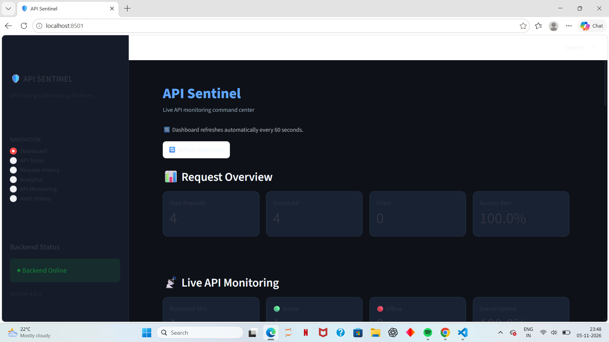
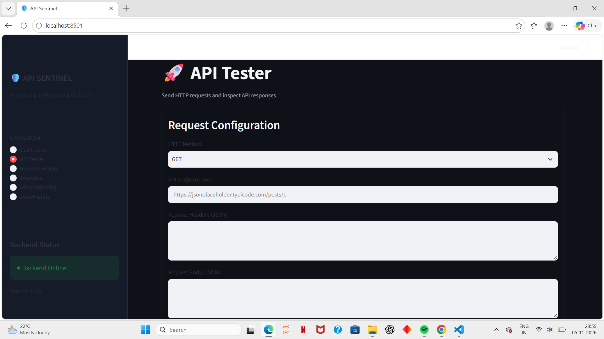
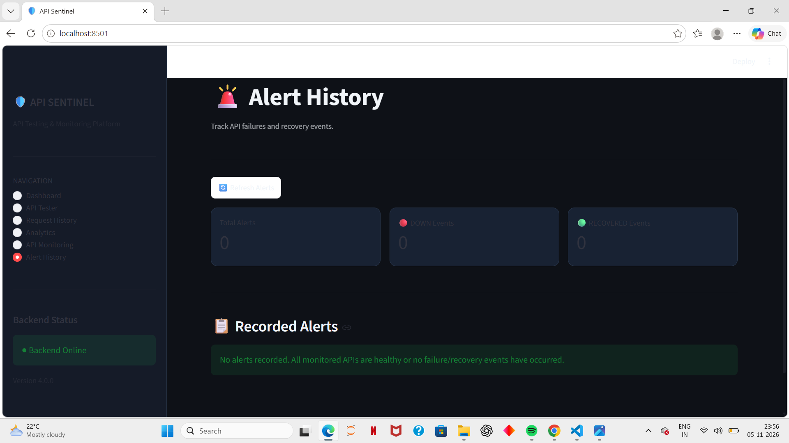

# 🛡️ API Sentinel

### API Testing and Monitoring Platform

API Sentinel is a Python-based API testing and monitoring platform that allows users to send HTTP requests, monitor API availability, analyze performance, and track failure and recovery events through a dark-themed dashboard.

## 🚀 Features

- **Dashboard:** Live API monitoring, request statistics, uptime comparison and response-time trends.
- **API Tester:** Execute GET, POST, PUT and DELETE requests.
- **Request History:** View and manage previously executed API requests.
- **Analytics:** Visualize request success rates, HTTP status codes and response times.
- **API Monitoring:** Register APIs and automatically monitor their availability.
- **Alert History:** Record and view API DOWN and RECOVERED events.

## 🛠️ Technologies Used

| Component         | Technology      |
| ----------------- | --------------- |
| Backend           | Python, FastAPI |
| Frontend          | Streamlit       |
| Database          | SQLite          |
| HTTP Client       | HTTPX           |
| Data Processing   | Pandas          |
| Visualization     | Plotly          |
| API Documentation | Swagger UI      |

## 📁 Project Structure

```text
API-Sentinel/
│
├── backend/
│   └── main.py
│
├── frontend/
│   └── app.py
│
├── database/
│   └── api_history.db
│
├── tests/
│
├── requirements.txt
├── .gitignore
└── README.md
```

## ⚙️ Installation and Setup

### 1. Clone the repository

```bash
git clone https://github.com/YOUR-USERNAME/API-Sentinel.git
cd API-Sentinel
```

### 2. Create a virtual environment

```bash
python -m venv .venv
```

### 3. Activate the environment

Windows CMD:

```cmd
.venv\Scripts\activate.bat
```

### 4. Install dependencies

```bash
pip install -r requirements.txt
```

### 5. Start the backend

```bash
python -m uvicorn backend.main:app --reload
```

Backend URL: http://127.0.0.1:8000

Swagger documentation: http://127.0.0.1:8000/docs

### 6. Start the frontend

Open a second terminal:

```bash
python -m streamlit run frontend/app.py
```

Frontend URL: http://localhost:8501

## 📊 Monitoring and Alert System

API Sentinel periodically checks registered APIs and records their availability, HTTP status codes and response times.

It generates alerts when:

- An API becomes unavailable (**DOWN**).
- An unavailable API becomes available again (**RECOVERED**).

Alert events are stored in SQLite and displayed in the Alert History section.

## 🔮 Future Improvements

- Email and real-time notifications.
- Authentication and user management.
- Advanced API security and validation.
- Automated unit and integration tests.
- Deployment with secure configuration.

## 📸 Project Screenshots

### 1. Dashboard



### 2. API Tester



### 3. Alert History



## 👩‍💻 Author

**Kanchana Sheelvanth**

GitHub: https://github.com/kanchana-git13

---

_Built as a practical software engineering project to explore API development, testing, monitoring and performance analytics._
